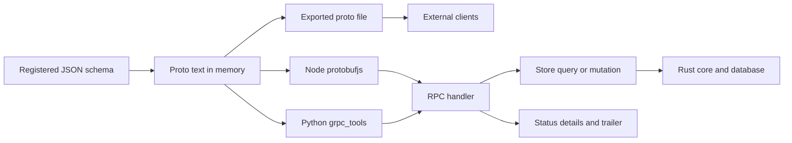

# store-grpc

**A standard gRPC service per model, generated from the JSON schema the store already holds — proto-first, zero protoc, no generated code on disk.**


中文: [README.md](./README.md) · Behaviour contract: [`spec/00`–`spec/03`](./spec/00-overview.md)

- Two runtimes, one contract: `store-grpc-node` (npm) and `store-grpc-py` (PyPI).
- The `.proto` is emitted from memory; the server registers the same text it exports.
- Node ≥ 18, Python ≥ 3.10; current release `0.2.5`.

## Suppose the contract is a file in git

Suppose three internal services share one accounts model. The accounts service owns the database; billing and reporting call it. The contract is a `.proto` committed to the accounts repository. Twelve models, five rpcs per model — sixty method signatures — and one generated DTO set per language. The first schema change that adds an optional field starts a small ritual: regenerate the file, align the `protoc` plugin version across three CI images, commit the generated code, and review a diff nobody reads line by line. The `.proto` says nothing about permissions, so the pipeline stays green when one model's read rule changes underneath it.

That is the tax this repository removes. `store-grpc` treats the registered JSON schema as the IDL source, builds the `.proto` text in memory at both build and serve time, and never writes generated code back into the repository. The contract still exists — you can export it for any external client — but it is derived from the schema, not maintained beside it.

## What it actually does

It is a protocol skin, not a data layer. For every model the store knows about, it emits one service with five unary rpcs and maps each rpc onto a store call that already exists. Auth, rate limiting, caching and dialect routing stay where they were.

| You declare in the schema | The gRPC surface gets |
|---|---|
| model `User` | `service User` with `ListUser`, `GetUser`, `CreateUser`, `UpdateUser`, `DeleteUser` |
| `_id` (default `id_field`) | the key used by `Get`, `Update`, `Delete` |
| archived `UserDeleted` while `User` exists | skipped, exactly as in the REST and GraphQL skins |
| `"x-grpc": {"hidden": true}` | the service is not generated at all |
| `"x-grpc": {"readonly": true}` | only `List` and `Get` are generated |
| model `description` | emitted as the service `//` comment, unchanged |

The five method names are fixed; nothing is invented per model.

| rpc | Request fields | Store call | Success |
|---|---|---|---|
| `ListUser` | `q`, `params_json` | `store.query(name + (q or proj), params)` | array as JSON |
| `GetUser` | `id` | `store.queryOne('User($condition: @c0)' + proj, { c0: { _id: id } })` | object JSON; empty ⇒ `NOT_FOUND` |
| `CreateUser` | `body_json` | `store.insert('User', JSON.parse(body_json))` | inserted document |
| `UpdateUser` | `id`, `set_json` | `store.update('User', { _id: id }, JSON.parse(set_json))` | `store.update`'s raw return, no re-read |
| `DeleteUser` | `id` | `store.remove('User', { _id: id })` | `store.remove`'s raw return |

`q` is the GQL remainder after the model name and is source-identical to REST's `?q=`. When `q` is empty, the adapter builds a projection ` { f1, f2 }` from the schema's `fields` and `computes`; when `q` is present, the adapter appends nothing. `proj` is empty when the upstream schema exposes no fields, so the reply carries only `_id` — the explicit consequence of an incomplete schema, same as REST.

## Key mechanisms

### The proto is built from memory

`buildProto` / `build_proto` is a pure string build with **zero gRPC dependency** — it reads `store.list()` and `store.get(name)` and prints the `.proto`. `exportProto` / `export_proto` returns the same text under the name that mirrors GraphQL's `exportSDL`, and is the artifact you hand to `protoc`, `grpcurl` or a client generator.

`createServer` / `create_server` registers that same text at runtime. Node parses it with `protobufjs` and hands grpc-js a hand-built `ServiceDefinition`; Python runs `grpc_tools.protoc` in-process to produce a descriptor set, builds message classes against a private descriptor pool, and caches them by the SHA-1 of the proto text. The compiled classes are exposed on the server handle as `server.pb`. Neither runtime writes a `.js` stub, a `_pb2.py`, or a `.pb.go`.

Scope rules are applied before a line of proto is printed:

- `package` is always `store.v0`.
- service name = model name with the first letter upper-cased, the rest verbatim (`user_profile` → `User_profile`).
- rpc name = `List` / `Get` / `Create` / `Update` / `Delete` + service name.
- two names that collide after upper-casing (`user` and `User`) raise `ERR_NAME_CONFLICT:` at build time; they are never merged silently.

### Dynamic serialization, one payload shape

v0 carries dynamic data as JSON strings: `q` + `params_json` in, `data_json` out; writes take `body_json` or `set_json`. The decision is recorded in `spec/01`: GQL queries and params are dynamic JSON by nature, so a string carries them with zero ambiguity and the lowest cross-runtime parity cost. Per-field typed messages are a v1 item and require a spec change first.

Field names in the `.proto` are always `snake_case`. Each runtime presents them per its protobuf convention: protobufjs exposes `dataJson`, `_pb2` keeps `data_json`, Go codegen produces `DataJson`. This is a declared language convention, not a parity defect; the adapter never rewrites across them.

Both runtimes generate the **same service tree** for the same schema — same package, same messages, same rpc signatures — and both execute the same shared `conformance/cases/*.json`, asserting identical status codes, error codes and JSON payloads. The executable contract is the rpc surface, not the wording of the generated comments.

### Errors, metadata, and the three states

A gRPC error has three parts: a `status` code, `details` carrying the store's original message verbatim (empty if unavailable, never fabricated), and a `store-error-code` trailer with a stable machine code. The trailer uses the same code table as REST's `error.code`.

There is also a `store-error-code-normalized` trailer carrying the normalized machine code (compatibility layer). For a typed `PermissionError`, `store-error-code` keeps its legacy value (`err.code` or the class name) while `store-error-code-normalized` is always `ERR_PERMISSION`; for all other codes the two are identical. The added trailer does not change existing `store-error-code` values.

| `store-error-code` | gRPC status | REST | Trigger |
|---|---|---|---|
| `INVALID_PARAM` | `INVALID_ARGUMENT` | 400 | `params_json` is not valid JSON |
| `INVALID_BODY` | `INVALID_ARGUMENT` | 400 | `body_json` / `set_json` is not a JSON object |
| `GQL_PARSE` | `INVALID_ARGUMENT` | 400 | core raises `ERR_GQL_PARSE:`; the prefix is stripped from details |
| `CONTEXT_ERROR` | `UNAUTHENTICATED` | 401 | the context hook throws a non-permission error |
| `ERR_PERMISSION` / permission class name | `PERMISSION_DENIED` | 403 | `PermissionError` type or the stable `ERR_PERMISSION:` prefix |
| `no_context` | `PERMISSION_DENIED` | 403 | host `NoContextError` or the `ERR_NO_CONTEXT:` prefix |
| `NOT_FOUND` / `ERR_NOT_FOUND` | `NOT_FOUND` | 404 | `queryOne` returned nothing, or the host/core raised `ERR_NOT_FOUND` (via `err.code` or the `ERR_NOT_FOUND:` prefix); the original message travels unchanged |
| `err.code` / class name | `INTERNAL` | 500 | everything else, message passed through |

The decision order is identical in both runtimes: adapter guards, then `NOT_FOUND` / `ERR_NOT_FOUND`, then `INVALID_PARAM` / `INVALID_BODY`, then `CONTEXT_ERROR`, then the `PermissionError` type check (never message matching), then the `ERR_PERMISSION:` prefix, then `no_context` / `ERR_NO_CONTEXT:`, then `ERR_GQL_PARSE:`, then the default `INTERNAL` bucket.

The skin does not collapse the store's three outcomes into a single auth failure:

| What happened | What this skin returns |
|---|---|
| the call is permitted | `StoreReply.data_json`; no error field exists in a successful reply |
| the row is missing | `Get` returns `NOT_FOUND` + `store-error-code: NOT_FOUND`; a host/core `ERR_NOT_FOUND` (code or `ERR_NOT_FOUND:` prefix) maps to the same status with its message intact — it is never folded into a permission denial, and never collapsed into `INTERNAL` |
| the row exists but the caller may not touch it | `PERMISSION_DENIED`, carrying the store's original permission wording, not re-wrapped into new text |

Identity travels as request metadata, not ambient state. `contextProvider` (Node) / `context_provider` (Python) receives this call's metadata and its return value is injected through `store.setContext(ctx)`. Returning `null` / `None` still injects explicitly, so a stateful runtime cannot leak the previous request's identity. A permission rejection is decided before the handler's semantics run: when the hook throws, the store is never called. A permission error becomes `PERMISSION_DENIED`; any other hook failure becomes `UNAUTHENTICATED` with the original message.

## Run it

```bash
# Node
npm install store-grpc-node @grpc/grpc-js protobufjs
npm install nodejs-store        # only when the server wraps a real store

# Python
pip install "store-grpc-py[grpc]"
pip install py-store            # only when the server wraps a real store
```

`buildProto` / `exportProto` and `build_proto` / `export_proto` work with no gRPC library installed at all; only the server entry points need the transport.

The Node example below is condensed from `node/test/smoke.test.js` — a mock store and a real grpc-js server. Replace the mock with `require('nodejs-store').store` for production.

```javascript
const grpc = require('@grpc/grpc-js');
const protobuf = require('protobufjs');
const { createServer } = require('store-grpc-node');

const store = {
  list: () => ['User'],
  get: () => ({
    name: 'User',
    fields: { _id: { type: 'string' }, name: { type: 'string' }, age: { type: 'int' } },
  }),
  query: async () => [{ _id: 'u1', name: 'alice', age: 30 }],
  queryOne: async () => ({ _id: 'u1', name: 'alice', age: 30 }),
  insert: async (_name, doc) => ({ _id: 'u1', ...doc }),
  update: async (_name, _cond, set) => ({ _id: 'u1', name: 'alice', ...set }),
  remove: async () => 1,
  setContext: async () => {},
};

(async () => {
  const { port, proto, shutdown } = await createServer(store, { port: 0 });
  const root = protobuf.parse(proto).root;
  const Req = root.lookupType('store.v0.ListRequest');
  const Reply = root.lookupType('store.v0.StoreReply');
  const method = {
    path: '/store.v0.User/ListUser',
    requestStream: false, responseStream: false,
    requestSerialize: (o) => Buffer.from(Req.encode(Req.fromObject(o)).finish()),
    requestDeserialize: (b) => Req.toObject(Req.decode(b)),
    responseSerialize: (o) => Buffer.from(Reply.encode(Reply.fromObject(o)).finish()),
    responseDeserialize: (b) => Reply.toObject(Reply.decode(b)),
  };
  const Client = grpc.makeGenericClientConstructor({ ListUser: method }, 'User');
  const client = new Client(`127.0.0.1:${port}`, grpc.credentials.createInsecure());

  client.ListUser({ q: ' { name, age }' }, async (err, reply) => {
    if (err) throw err;
    console.log(JSON.parse(reply.dataJson)); // [ { _id: 'u1', name: 'alice', age: 30 } ]
    client.close();
    await shutdown();
  });
})();
```

The Python example is condensed from `py/tests/test_smoke.py` — the same mock-store shape, a real grpcio server, and the compiled message classes on `server.pb`.

```python
import grpc
from store_grpc import create_server


class Store:
    list = staticmethod(lambda: ["User"])
    get = staticmethod(lambda name: {"name": "User", "fields": {
        "_id": {"type": "string"}, "name": {"type": "string"}, "age": {"type": "int"}}})

    async def query(self, gql, params=None):
        return [{"_id": "u1", "name": "alice", "age": 30}]

    async def query_one(self, gql, params=None):
        return {"_id": "u1", "name": "alice", "age": 30}

    async def insert(self, name, data):
        return {"_id": "u1", **data}

    async def update(self, name, cond, data):
        return {"_id": "u1", "name": "alice", **data}

    async def remove(self, name, cond):
        return 1

    async def set_context(self, ctx):
        pass


server = create_server(Store(), port=0)
channel = grpc.insecure_channel(f"127.0.0.1:{server.port}")
list_user = channel.unary_unary(
    "/store.v0.User/ListUser",
    request_serializer=server.pb.ListRequest.SerializeToString,
    response_deserializer=server.pb.StoreReply.FromString,
)
print(list_user(server.pb.ListRequest(q=" { name, age }")).data_json)
channel.close()
server.stop(None)
```

In production, pass `port=50051` and call `server.stop(None)` on shutdown; on Node, `shutdown()` resolves after `tryShutdown`. `port: 0` asks the OS for a free port, which is what the tests use.

## Boundaries: when not to use it

- **You need semantics the store does not have.** The first hard law is zero semantic invention: no auth, no rate limiting, no caching, no business rules. Those belong in the host or a gateway. Every rpc is unary — streaming is not in v0.
- **You need per-field typed DTOs today.** v0 carries `q`, `params` and the document as JSON strings. Typed messages require a spec change and a coordinated release of both runtimes; they are a v1 direction, not a runtime option.
- **You want browser-native calls or server reflection.** gRPC over HTTP/2 is not directly callable from browsers and gRPC-Web is out of scope; `grpcurl` needs the exported `.proto` passed with `-proto`, because v0 has no reflection service.
- **You plan to patch one runtime only.** The second hard law is parity first: change `spec/`, then both runtimes, then the conformance cases. Spec, code and cases disagreeing is a defect, not a local fix.
- **You want errors softened or defaulted.** The third hard law is no error masking: no catch-and-return-success, no default fallback, no treating a neutral result as an error. An unrecognised store error is `INTERNAL` with its original message, not a friendly rewrite.

There is also no row-count guard at this skin. GraphQL's default-50 / cap-1000 belongs to that skin's spec; gRPC passes `q` through like REST, and the core's cap applies in the text2query tier.

## Where it sits in the family

This is the gRPC skin over the same JSON schema as the REST skin ([store-api](https://github.com/coenddt/store-api)), the GraphQL skin ([store-graphql](https://github.com/coenddt/store-graphql)) and the MCP skin ([store-mcp](https://github.com/coenddt/store-mcp)); [store-gateway](https://github.com/coenddt/store-gateway) composes them behind one entry point, it runs on [nodejs-store](https://github.com/coenddt/nodejs-store) and [py-store](https://github.com/coenddt/py-store) while permissions, command planning, computed columns and SQL dialects live in [rust-store](https://github.com/coenddt/rust-store), and the control plane, scaffold and bootstrap plugins are [meta-store](https://github.com/coenddt/meta-store), [create-store-app](https://github.com/coenddt/create-store-app), [store-rbac-bootstrap](https://github.com/coenddt/store-rbac-bootstrap) and [store-resource-bootstrap](https://github.com/coenddt/store-resource-bootstrap).

## One diagram



MIT — see [LICENSE](./LICENSE).
