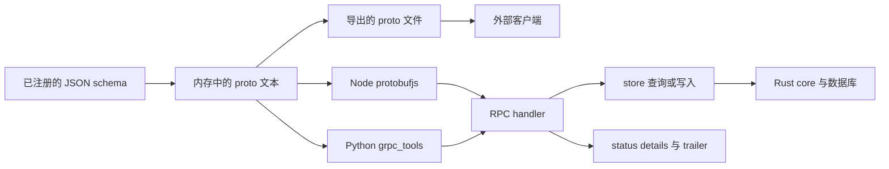

# store-grpc

**为 store 里已有的 JSON schema 生成标准 gRPC 服务，每个模型一个——proto 优先，零 protoc，磁盘上不留生成代码。给需要在内部服务间暴露强契约、又不想维护生成代码的团队用。**


中文（本页） · 行为契约：[`spec/00`–`spec/03`](./spec/00-overview.md) · English: [README.en.md](./README.en.md)

- 两个运行时，一份契约：`store-grpc-node`（npm）与 `store-grpc-py`（PyPI）。
- `.proto` 从内存生成；服务器注册的就是它导出的那份文本。
- Node ≥ 18，Python ≥ 3.10；当前发布 `0.2.5`。

## 假设契约是 git 里的一个文件

三个内部服务共用一个账号模型。账号服务持有数据库，计费与报表调它。契约是一个提交在账号仓库里的 `.proto`：12 个模型，每模型 5 个 rpc——60 个方法签名，每种语言一套生成的 DTO。

第一个「加个可选字段」的 schema 变更，会启动一套小仪式：重新生成文件，在三个 CI 镜像里对齐 `protoc` 插件版本，提交生成代码，再 review 一份没人逐行看的 diff。而 `.proto` 对权限只字不提，所以某个模型的读规则在底下变了，流水线依然是绿的。

这就是本仓要去掉的那笔税。`store-grpc` 把已注册的 JSON schema 当作 IDL 源，在构建期与运行期都把 `.proto` 文本建在内存里，从不把生成代码写回仓库。契约依然存在——你可以导出给任何外部客户端——但它是从 schema 推导出来的，不是并排维护的第二份。

## 它到底做什么

它是一层协议皮，不是数据层。store 知道的每个模型，它生成一个含五个一元 rpc 的 service，并把每个 rpc 映射到一次已经存在的 store 调用。鉴权、限流、缓存、方言路由都留在原地。

| 你在 schema 里声明 | gRPC 面得到 |
|---|---|
| 模型 `User` | `service User`，含 `ListUser`、`GetUser`、`CreateUser`、`UpdateUser`、`DeleteUser` |
| `_id`（缺省 `idField`） | `Get`、`Update`、`Delete` 使用的定位键 |
| 归档的 `UserDeleted`，而 `User` 存在 | 跳过，与 REST、GraphQL 皮肤一致 |
| `"x-grpc": {"hidden": true}` | 完全不生成 service |
| `"x-grpc": {"readonly": true}` | 只生成 `List` 与 `Get` |
| 模型的 `description` | 原样写成 service 的 `//` 注释 |

五个方法名是固定的，不为任何模型发明新动词。

| rpc | 请求字段 | store 调用 | 成功 |
|---|---|---|---|
| `ListUser` | `q`、`params_json` | `store.query(name + (q or proj), params)` | 数组 JSON |
| `GetUser` | `id` | `store.queryOne('User($condition: @c0)' + proj, { c0: { _id: id } })` | 对象 JSON；空 ⇒ `NOT_FOUND` |
| `CreateUser` | `body_json` | `store.insert('User', JSON.parse(body_json))` | 插入后的文档 |
| `UpdateUser` | `id`、`set_json` | `store.update('User', { _id: id }, JSON.parse(set_json))` | `store.update` 的原始返回，不回读 |
| `DeleteUser` | `id` | `store.remove('User', { _id: id })` | `store.remove` 的原始返回 |

`q` 是去掉模型名后的 GQL 余部，与 REST 的 `?q=` 同源。`q` 为空时，适配器按 schema 的 `fields` 与 `computes` 拼出投影 ` { f1, f2 }`；`q` 存在时不再追加。上游 schema 没有字段时 `proj` 为空，回复只带 `_id`——这是 schema 不完整的显式后果，与 REST 相同。

## 关键机制

### proto 从内存构建

`buildProto` / `build_proto` 是一次纯字符串构建，**零 gRPC 依赖**——它读 `store.list()` 与 `store.get(name)`，打印 `.proto`。`exportProto` / `export_proto` 返回同一份文本，命名对齐 GraphQL 的 `exportSDL`，也是你交给 `protoc`、`grpcurl` 或客户端生成器的产物。

`createServer` / `create_server` 在运行期注册同一份文本。Node 用 `protobufjs` 解析，交给 grpc-js 一个手工构建的 `ServiceDefinition`；Python 在进程内跑 `grpc_tools.protoc` 产出 descriptor set，用私有 descriptor pool 构造消息类，并按 proto 文本的 SHA-1 缓存。编译出的类挂在 server 句柄的 `server.pb` 上。两个运行时都不写 `.js` stub、`_pb2.py` 或 `.pb.go`。

打印第一行 proto 之前，作用域规则已经生效：

- `package` 恒为 `store.v0`。
- service 名 = 模型名首字母大写、其余原样（`user_profile` → `User_profile`）。
- rpc 名 = `List` / `Get` / `Create` / `Update` / `Delete` + service 名。
- 两个名字大写后相撞（`user` 与 `User`）在构建期抛 `ERR_NAME_CONFLICT:`，绝不静默合并。

### 动态序列化，一种载荷形状

v0 把动态数据装成 JSON 字符串：进 `q` + `params_json`，出 `data_json`；写操作收 `body_json` 或 `set_json`。这个决定记录在 `spec/01`：GQL 查询与参数本质上是动态 JSON，用字符串承载零歧义，跨运行时 parity 成本最低。逐字段类型化消息是 v1 事项，且必须先改 spec。

`.proto` 里的字段名恒为 `snake_case`。各运行时按自己的 protobuf 惯例呈现：protobufjs 暴露 `dataJson`，`_pb2` 保留 `data_json`，Go codegen 产出 `DataJson`。这是已声明的语言惯例，不是 parity 缺陷；适配器不做跨语言改写。

两个运行时为同一份 schema 生成**相同的 service 树**——同 package、同 message、同 rpc 签名——并执行同一批 `conformance/cases/*.json`，断言相同的状态码、错误码与 JSON 载荷。可执行契约是 rpc 面，不是生成注释的措辞。

### 错误、metadata 与三种状态

一个 gRPC 错误有三部分：`status` 码，原样承载 store 原始 message 的 `details`（取不到则空串，绝不编造），以及带稳定机器码的 `store-error-code` trailer。trailer 用的码表与 REST 的 `error.code` 相同。

| `store-error-code` | gRPC status | REST | 触发 |
|---|---|---|---|
| `INVALID_PARAM` | `INVALID_ARGUMENT` | 400 | `params_json` 不是合法 JSON |
| `INVALID_BODY` | `INVALID_ARGUMENT` | 400 | `body_json` / `set_json` 不是 JSON 对象 |
| `GQL_PARSE` | `INVALID_ARGUMENT` | 400 | core 抛 `ERR_GQL_PARSE:`；details 剥掉前缀 |
| `CONTEXT_ERROR` | `UNAUTHENTICATED` | 401 | context hook 抛非权限错误 |
| `ERR_PERMISSION` / 权限类名 | `PERMISSION_DENIED` | 403 | `PermissionError` 类型或稳定前缀 `ERR_PERMISSION:` |
| `no_context` | `PERMISSION_DENIED` | 403 | 宿主 `NoContextError` 或 `ERR_NO_CONTEXT:` 前缀 |
| `NOT_FOUND` | `NOT_FOUND` | 404 | `queryOne` 返回空；或宿主/core 抛 `ERR_NOT_FOUND` / `ERR_NOT_FOUND:` |
| `err.code` / 类名 | `INTERNAL` | 500 | 其余一切，message 原样透传 |

判定顺序在两个运行时完全一致：适配器守卫 → `PermissionError` 类型判定（绝不按文案匹配）→ `ERR_PERMISSION:` 前缀 → `no_context` / `ERR_NO_CONTEXT:` → `ERR_GQL_PARSE:` → 默认 `INTERNAL` 桶。

这层皮肤不把 store 的三种结果压成同一种鉴权失败：

| 发生了什么 | 这层皮肤返回什么 |
|---|---|
| 调用被允许 | `StoreReply.data_json`；成功回复里不存在 error 字段 |
| 行不存在 | `Get` 返回 `NOT_FOUND` + `store-error-code: NOT_FOUND` |
| 行存在但调用方无权操作 | `PERMISSION_DENIED`，携带 store 原始权限措辞，不重新包装 |

身份随请求 metadata 传递，不是环境状态。`contextProvider`（Node）/ `context_provider`（Python）收到本次调用的 metadata，其返回值经 `store.setContext(ctx)` 注入。返回 `null` / `None` 同样显式注入，所以有状态的运行时无法残留上一个请求的身份。权限拒绝在 handler 语义执行之前判定：hook 抛错时，store 根本不会被调用。权限错误变成 `PERMISSION_DENIED`；其余 hook 失败变成 `UNAUTHENTICATED`，附原始 message。

## 跑起来

```bash
# Node
npm install store-grpc-node @grpc/grpc-js protobufjs
npm install nodejs-store        # 仅当 server 包真实 store 时需要

# Python
pip install "store-grpc-py[grpc]"
pip install py-store            # 仅当 server 包真实 store 时需要
```

`buildProto` / `exportProto` 与 `build_proto` / `export_proto` 完全不需要装 gRPC 库；只有 server 入口需要传输层。

下面这段 Node 示例取自 `node/test/smoke.test.js`——一个 mock store 加真实 grpc-js server。生产环境把 mock 换成 `require('nodejs-store').store`。

```javascript
const grpc = require('@grpc/grpc-js');
const protobuf = require('protobufjs');
const { createServer } = require('store-grpc-node');

const store = {
  list: () => ['User'],
  get: () => ({
    name: 'User',
    fields: { _id: { type: 'string' }, name: { type: 'string' }, age: { type: 'int' } },
  }),
  query: async () => [{ _id: 'u1', name: 'alice', age: 30 }],
  queryOne: async () => ({ _id: 'u1', name: 'alice', age: 30 }),
  insert: async (_name, doc) => ({ _id: 'u1', ...doc }),
  update: async (_name, _cond, set) => ({ _id: 'u1', name: 'alice', ...set }),
  remove: async () => 1,
  setContext: async () => {},
};

(async () => {
  const { port, proto, shutdown } = await createServer(store, { port: 0 });
  const root = protobuf.parse(proto).root;
  const Req = root.lookupType('store.v0.ListRequest');
  const Reply = root.lookupType('store.v0.StoreReply');
  const method = {
    path: '/store.v0.User/ListUser',
    requestStream: false, responseStream: false,
    requestSerialize: (o) => Buffer.from(Req.encode(Req.fromObject(o)).finish()),
    requestDeserialize: (b) => Req.toObject(Req.decode(b)),
    responseSerialize: (o) => Buffer.from(Reply.encode(Reply.fromObject(o)).finish()),
    responseDeserialize: (b) => Reply.toObject(Reply.decode(b)),
  };
  const Client = grpc.makeGenericClientConstructor({ ListUser: method }, 'User');
  const client = new Client(`127.0.0.1:${port}`, grpc.credentials.createInsecure());

  client.ListUser({ q: ' { name, age }' }, async (err, reply) => {
    if (err) throw err;
    console.log(JSON.parse(reply.dataJson)); // [ { _id: 'u1', name: 'alice', age: 30 } ]
    client.close();
    await shutdown();
  });
})();
```

Python 示例取自 `py/tests/test_smoke.py`——同样的 mock store 形状，真实 grpcio server，编译好的消息类在 `server.pb` 上。

```python
import grpc
from store_grpc import create_server


class Store:
    list = staticmethod(lambda: ["User"])
    get = staticmethod(lambda name: {"name": "User", "fields": {
        "_id": {"type": "string"}, "name": {"type": "string"}, "age": {"type": "int"}}})

    async def query(self, gql, params=None):
        return [{"_id": "u1", "name": "alice", "age": 30}]

    async def query_one(self, gql, params=None):
        return {"_id": "u1", "name": "alice", "age": 30}

    async def insert(self, name, data):
        return {"_id": "u1", **data}

    async def update(self, name, cond, data):
        return {"_id": "u1", "name": "alice", **data}

    async def remove(self, name, cond):
        return 1

    async def set_context(self, ctx):
        pass


server = create_server(Store(), port=0)
channel = grpc.insecure_channel(f"127.0.0.1:{server.port}")
list_user = channel.unary_unary(
    "/store.v0.User/ListUser",
    request_serializer=server.pb.ListRequest.SerializeToString,
    response_deserializer=server.pb.StoreReply.FromString,
)
print(list_user(server.pb.ListRequest(q=" { name, age }")).data_json)
channel.close()
server.stop(None)
```

生产环境传 `port=50051`，关闭时调 `server.stop(None)`；Node 的 `shutdown()` 在 `tryShutdown` 完成后 resolve。`port: 0` 让 OS 分配空闲端口，测试用的就是它。

## 边界：什么时候不要用它

- **需要 store 没有的语义。** 第一条铁律是零语义发明：不做鉴权、不限流、不缓存、不写业务规则。它们属于宿主或网关。所有 rpc 都是一元的——流式不在 v0。
- **今天就要逐字段类型化 DTO。** v0 把 `q`、`params` 和文档都装成 JSON 字符串。类型化消息需要改 spec，并协调两个运行时一起发布；那是 v1 方向，不是运行时开关。
- **要浏览器原生调用或 server reflection。** gRPC over HTTP/2 不能从浏览器直接调，gRPC-Web 不在范围内；`grpcurl` 必须用 `-proto` 传入导出的 `.proto`，因为 v0 没有反射服务。
- **打算只补一个运行时。** 第二条铁律是 parity 优先：先改 `spec/`，再改两个运行时，最后改 conformance。spec、代码、用例三者不一致就是缺陷，不是本地修补。
- **希望错误被软化或兜底。** 第三条铁律是不掩盖错误：不 catch 后返回成功，不给默认回退，不把中性结果当错误。不认识 store 错误就归 `INTERNAL` 并保留原始 message，不做友好化改写。

这层皮肤也没有行数守卫。GraphQL 的缺省 50 / 上限 1000 属于那层皮肤的 spec；gRPC 与 REST 一样把 `q` 透传下去，行数封顶由 core 在 text2query 档生效。

## 在家族里的位置

它是同一份 JSON schema 之上的 gRPC 皮肤，与 REST 皮肤（[store-api](https://github.com/coenddt/store-api)）、GraphQL 皮肤（[store-graphql](https://github.com/coenddt/store-graphql)）、MCP 皮肤（[store-mcp](https://github.com/coenddt/store-mcp)）同源；[store-gateway](https://github.com/coenddt/store-gateway) 把它们组合在一个入口后面。它跑在 [nodejs-store](https://github.com/coenddt/nodejs-store) 与 [py-store](https://github.com/coenddt/py-store) 上，权限、命令规划、计算列与 SQL 方言在 [rust-store](https://github.com/coenddt/rust-store)；控制面、脚手架与引导插件分别是 [meta-store](https://github.com/coenddt/meta-store)、[create-store-app](https://github.com/coenddt/create-store-app)、[store-rbac-bootstrap](https://github.com/coenddt/store-rbac-bootstrap) 与 [store-resource-bootstrap](https://github.com/coenddt/store-resource-bootstrap)。

## 一图看懂



三句话：schema 就是 IDL；proto 只在内存里，磁盘上没有生成代码；错误原样透传，三种状态互不折叠。

MIT —— 见 [LICENSE](./LICENSE)。
